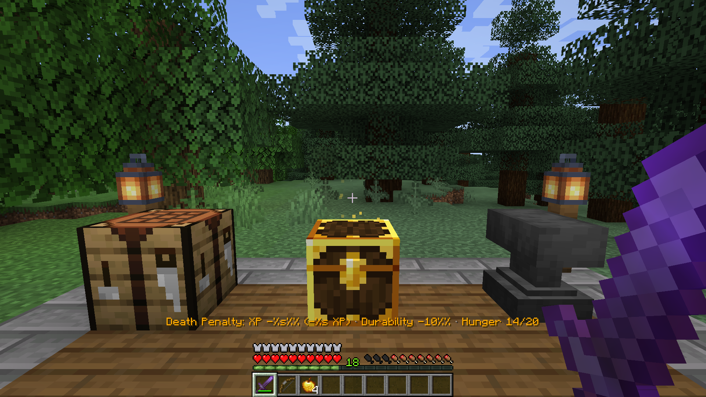
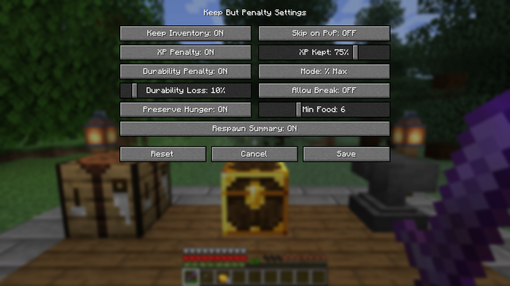

# Keep But Penalty

<p align="center">
  
</p>

**Keep your items when you die without making death free.**

**Keep But Penalty** preserves player inventories on death (without changing your world's `keepInventory` gamerule) and replaces frustrating item-recovery runs with configurable experience loss, gear durability wear, hunger preservation, and optional respawn debuffs.



## What Happens on Death

- **Keep your gear, leave world gamerules intact**: Players keep their inventory, armor, offhand, and curios/trinkets on death while your world's `keepInventory` gamerule stays untouched.
- **Configurable XP loss**: Keep a set percentage of total experience (default `75%`, losing `25%`). Experience is recalculated cleanly on respawn without triggering XP orb sounds or Mending repairs.
- **Equipment durability wear**: Deducts a percentage of max durability (default `10%`) or a flat amount from equipped armor, held items, and optional **Curios**, **Trinkets**, or **Accessories** slots.
  - **Won't shatter your gear by default**: With `allowBreak = false` (default), death wear stops at `1` durability so penalties never destroy an item outright. If you opt into `allowBreak = true`, items reaching `0` break normally (and respect anti-break mods like *Keep My Sword*). Vanilla Elytra always stops at its `1`-durability broken-wing state.
  - **Item & tag exclusions**: Skip specific items or tags via `excludedItems` (`#keep_but_penalty:excluded`, Tinkers' Construct, Tetra, and SlashBlade tools are excluded by default).
- **No dying to refill hunger**: Preserves below-full hunger across death with a configurable floor (`minRespawnFoodLevel = 6`, 3 drumsticks), preventing both free hunger resets and endless starvation loops.
- **Optional respawn debuffs & actionbar summary**: Apply status effects that scale up on consecutive deaths, and show a brief actionbar summary of what the death cost you.



## Configuration

Edit in-game via **Mod Menu** (Fabric) or the **Mods → Config** screen (Forge / NeoForge), or edit `config/keep_but_penalty.toml`:

```toml
[death]
keepInventory = true
enableExperiencePenalty = true
experienceKeepRatio = 0.75
preserveHungerOnDeath = true
minRespawnFoodLevel = 6
skipOnPvp = false
respawnDebuffs = []
respawnDebuffDurationsSecondsByDeath = []
respawnDebuffStreakResetSeconds = 600
showRespawnSummary = true

[durability]
enableDurabilityPenalty = true
penaltyMode = "PERCENT_MAX"
durabilityPercent = 0.1
durabilityFlat = 80
allowBreak = false
damageArmor = true
damageMainHand = true
damageOffHand = true
damageCurios = true
damageTrinkets = true
damageAccessories = true
excludedItems = ["#keep_but_penalty:excluded", "#tconstruct:modifiable", "#tetra:modular_items", "#slashblade:swords"]
```
